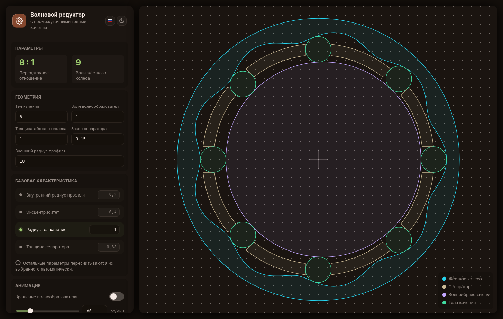

# Генератор волнового редуктора

Интерактивное веб-приложение для моделирования **волнового редуктора с промежуточными телами качения (ПТК)**: задаёте геометрию, смотрите работу кинематической схемы в 2D и экспортируете профили деталей в **SVG** и **DXF**.



## Зачем этот проект

Проект я создавал, чтобы **изучить принципы fine-grained реактивности** в современных фреймворках вроде Svelte и SolidJS, а также пощупать их на практической задаче с настоящими вычислениями и сложной зависимостью состояния. При этом само приложение должно было ощущаться как standalone. Поэтому:

- **никакого фреймворка** — ядро реактивности и DOM-слой написаны с нуля в `src/core/`;
- **никакого бандлера и зависимостей** — приложение собирается из обычных JS-файлов, подключённых в `index.html`;
- весь UI построен на реактивных примитивах `$state` / `$derived` / `$effect`, и при изменении параметра пересчитывается и обновляется только та часть DOM, которая от него зависит.

## Возможности

- Интерактивная 2D-визуализация: жёсткое колесо, сепаратор, волнообразователь, тела качения;
- Анимация вращения волнообразователя с настраиваемой скоростью (об/мин): тела качения катаются по профилю, сепаратор поворачивается с передаточным отношением;
- Автоматический расчёт производных параметров: передаточное отношение, число волн жёсткого колеса, радиусы, эксцентриситет, толщина сепаратора;
- Выбор **базовой характеристики** (внутренний радиус, эксцентриситет, радиус тел, толщина сепаратора) — остальные параметры пересчитываются из выбранной;
- Валидация геометрии: если редуктор с заданными параметрами геометрически не существует — приложение подсказывает об этом;
- Экспорт профиля: **SVG** (слои Inkscape, единицы — мм, параметры геометрии в метаданных) и **DXF R2013**, оба варианта с выбором приближения профиля прямыми или сплайнами.

## Как запустить

Сборка не нужна — просто откройте `index.html` в браузере или запустите любой статический сервер:

```sh
python3 -m http.server
# or
npx serve
```

> Единственный внешний ресурс — шрифты Google Fonts (Inter, JetBrains Mono); без сети приложение работает с системными шрифтами.

## Структура проекта

```
.
├── index.html               # точка входа: подключение всех скриптов
├── assets/                  # иконки
└── src/
    ├── index.js             # запуск приложения: локаль, тема, монтирование
    ├── config.js            # окружение
    ├── mini-modules.js      # ленивая модульная система mod() / mod.sync()
    ├── style.css            # темы оформления
    ├── core/
    │   ├── reactivity.js    # ядро реактивности: $state, $derived, $effect
    │   └── jsx.js           # DOM-слой: jsx(), $text, $each, $switch, bind:*
    ├── app/
    │   ├── store.js         # реактивный стейт параметров редуктора
    │   ├── harmonicDrive.js # геометрия: расчёт зависимых параметров, профили
    │   ├── theme.js         # темы system / light / dark
    │   ├── index.js         # корневой компонент
    │   ├── components/      # UI: панели, холст, контролы, иконки
    │   └── exports/
    │       ├── svg.js       # экспорт в SVG
    │       └── dxf.js       # экспорт в DXF (R2013)
    └── utils/
        ├── approxBezier.js  # приближение дискретной кривой кривыми Безье
        ├── gl-matrix.js     # минимальная библиотека векторной алгебры
        ├── i18n.js          # локализация RU / EN
        └── index.js         # gcd, roundTo, fmt, cn
```

## Реактивность своими руками

Минимальный набор примитивов в `src/core/reactivity.js`:

```js
const rpm = $state(60);                                   // состояние: getter/setter в одной функции
const label = $derived(() => `${rpm()} об/мин`);          // производное: мемоизировано, пересчитывается при изменении rpm
$effect(() => { localStorage.setItem("rpm", rpm()); });   // эффект: зависимости отслеживаются автоматически
```

- `$state` — реактивное состояние; объекты оборачиваются в `Proxy`, поэтому реактивность глубокая (как в SolidJS / Svelte);
- `$derived` — мемоизированное производное значение, пересчитывается только когда изменилась хотя бы одна зависимость;
- `$effect` — эффект с автоматическим отслеживанием: зависимости определяются по тому, какие состояния были **прочитаны** в теле эффекта;
- обновления собираются пачками и выполняются в микротаске, с защитой от циклов в графе зависимостей.

Над примитивами лежит DOM-слой (`src/core/jsx.js`), работающий по принципу fine-grained обновлений, без виртуального DOM:

- атрибуты, переданные функцией, являются реактивными и обновляются адресно;
- `$text` обновляет текст-ноду, `$each` / `$switch` / `$portal` работают через якорные комментарий-ноды;
- `bind:value`, `bind:group`, `bind:this` — двунаправленное связывание с input-элементами и ссылками на DOM-узлы;
- `onMount` / `onDestroy` — жизненный цикл компонента.

Модульная система `mod()` / `mod.sync()` из `src/mini-modules.js` заменяет сборщик: каждый модуль инициализируется лениво при первом вызове `__имя_модуля()`.

## Геометрия

Волновой редуктор с ПТК состоит из **волнообразователя** (вход, `zWaves` волн), **жёсткого колеса** (`zHard = zBalls + zWaves` волн) и `zBalls` **тел качения**, удерживаемых сепаратором. Передаточное отношение `i = zBalls : zWaves`.

Расстояние от центра до точки контакта тела качения задаётся в полярных координатах:

$$l(\phi) = e \cos(z \phi) + \sqrt{(r_{ball} + r_{disk})^2 - (e \sin(z \phi))^2}$$

где $e$ — эксцентриситет волнообразователя, $z$ — число волн. Профиль жёсткого колеса — огибающая окружностей радиуса $r_{ball}$ с центрами на траектории $l(\phi)$; он вычисляется аналитически, а для экспорта [приближается кубическими кривыми Безье](`src/utils/approxBezier.js`).

При экспорте в **DXF** данные SVG-путей парсятся и преобразуются в сущности `CIRCLE` / `LWPOLYLINE` / `ARC` / `SPLINE` (формат AC1015, единицы — мм), поэтому файлы открываются в CAD/CAM-программах без потерь точности.

## Технологии

- Обычный JavaScript (ES2023), классические `<script>`-теги — без бандлера и без зависимостей;
- JSDoc-аннотации типов, проверяемые TypeScript-компилятором (`checkJs`, см. `tsconfig.json`);
- SVG генерируется при помощи того же `jsx()`, что и UI, но в отдельный XML-документ.

## Лицензия

[GPL v3](./LICENSE) &copy; Dydykin Oleg
